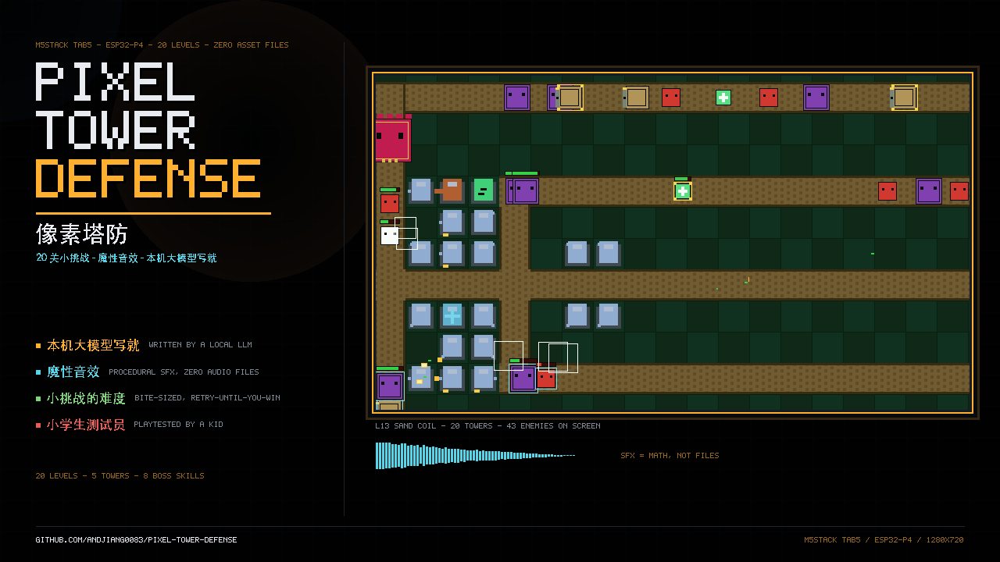
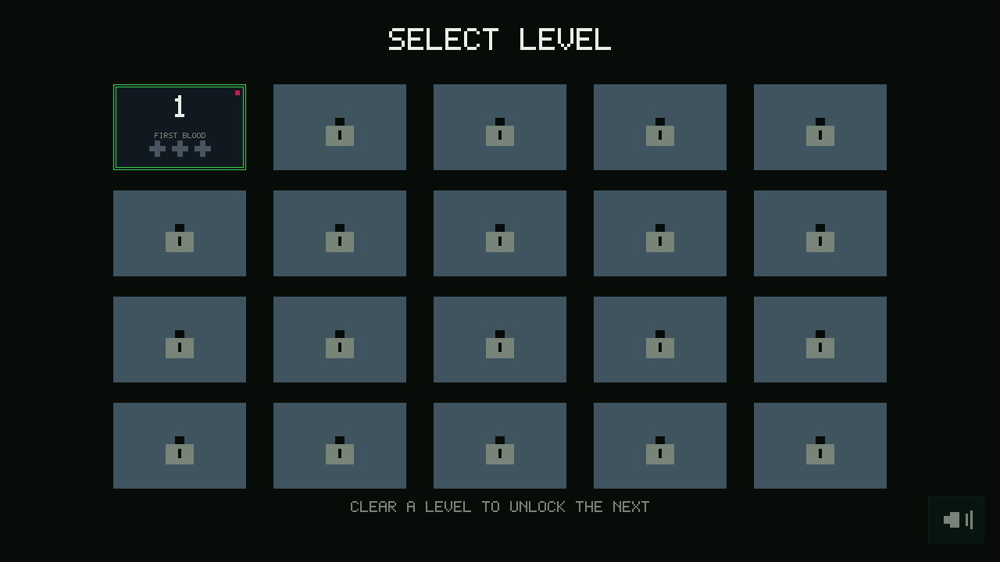
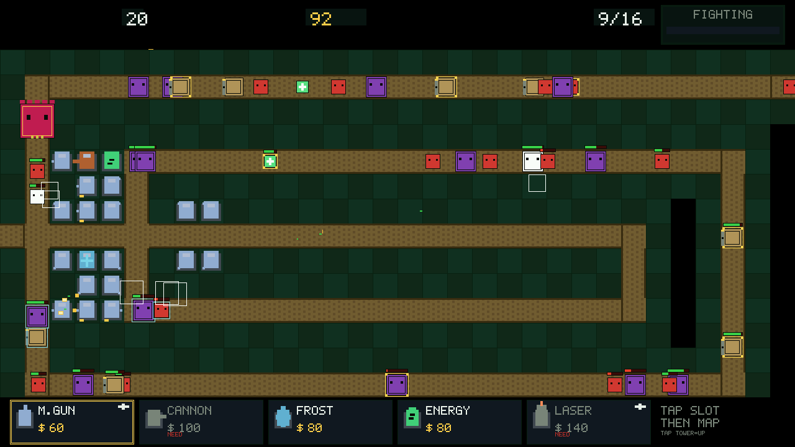
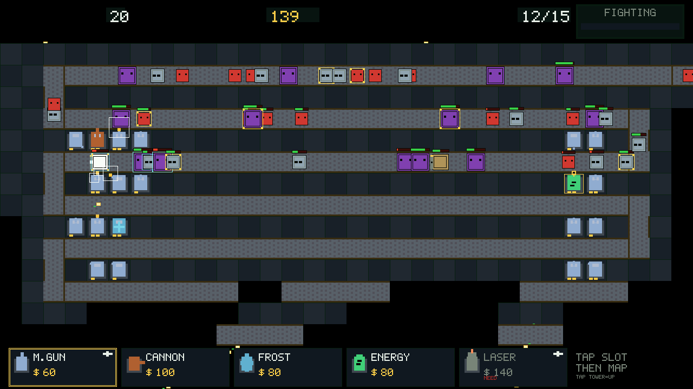
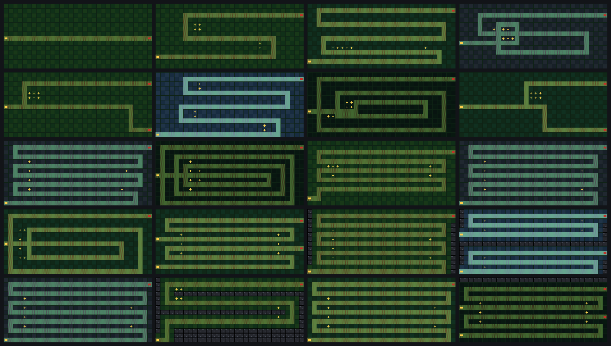

# PIXEL TOWER DEFENSE

**M5Stack Tab5 上的一台像素塔防 —— 每一颗像素都是 `fillRect`，每一声都是算出来的。
没有图片文件，没有音频文件，没有第三方字体。**

[English README →](README.md) · [构建与刷机 →](BUILDING_CN.md) · [参与贡献 →](CONTRIBUTING_CN.md) · [English contributing →](CONTRIBUTING.md)



> 这个仓库的架构和大部分代码，是**本机大模型**写的（作者 Mac 上跑的 4-bit
> Qwen3.8-Flash-Next，不是云端模型）。人负责定目标、玩、挑毛病；难度几乎全部
> 由一个**小学生测试员**的反馈改出来。详见 [CREDITS.md](CREDITS.md)。

## 这是什么

1280×720 触摸屏上的**建迷宫式塔防**，20 关。敌人从右边出生，沿固定路线走向你
的基地；你花金币建五种塔、升级、尽力守住 20 条命。

后面的关卡是**岩地**：大片地面不可建塔，好位置变成一份必须精打细算的预算——
不是数值变大，而是"能用的地方变少"。

它有一个很硬的约束：**整个仓库里没有任何素材文件**。5×7 字库是 95 个手写位图，
所有音效 PCM 都是构建期合成的（方波、扫频、一个 LFSR 噪声源），所有敌人、塔、
子弹、UI 都是矩形堆出来的。克隆下来编译，除了工具链什么都不会下载。

| | |
|---|---|
| 设备 | M5Stack Tab5（ESP32-P4，16 MB flash，PSRAM 200 MHz） |
| 屏幕 | 1280×720 MIPI-DSI，40 px 一格，32×14 网格 |
| 操作 | 纯触摸（这台设备没有实体按键） |
| 关卡 | 20 关（另有"无尽模式"引擎，UI 未接线，见*现状*） |
| 塔 | 5 种，各 3 级（每级射程 +25%、伤害 ×1.5） |
| 敌人 | 9 种，含空中单位（直线飞向基地）与治疗兵 |
| BOSS | 8 种技能；一关最多两只王，还有中段小 Boss |
| RAM / Flash | v0.4.0 构建占用 35,472 B（6.9%）/ 819,150 B（26.0%） |

## 四个卖点

1. **本机大模型写就** —— 架构与大部分代码由本机跑的 4-bit 大模型写成，慢、笨、
   但确实写完了。这不是营销词，仓库里的交接口令（`HANDOFF.md`）就是给模型看的。
2. **魔性音效** —— 没有一个音频文件：机枪"哒"、加农"咚"、爆炸"轰+碎"全部由
   方波/扫频/噪声在构建期算出来。仓库里甚至留了生成器（`tools/gen_sfx.py`），
   改一个常数，音色就变。
3. **小挑战的难度** —— 一关十分钟以内，失败可以渐进挽救；设计目标是"不能轻易
   过关、一定重开"，但**每一关都必须有多条活路**（不许出现围棋式的唯一解）。
4. **小学生测试员亲手测试** —— 难度、波量、BOSS 手感都是他打出来的：
   "太简单、内容太短、一波敌人太少、BOSS 太容易"直接改成了 v0.4 的方向。

## 截图

下面全是**游戏自己渲染出的真实画面**（PC 仿真跑固件源码导出，不是示意图）：

| 选关界面 | 第 13 关 SAND COIL |
|---|---|
|  |  |

| 第 12 关 HAIRPIN RIDGE | 20 张地图总览（审计渲染） |
|---|---|
|  |  |

## 安装

**最省事：M5Burner。** 在 [M5Burner](https://burner.m5stack.com) 或桌面版里搜
*PIXEL TOWER DEFENSE* 刷入。网页版与桌面版都把整个镜像写到 0x0 偏移，这正是
Release 里 `*-merged.bin` 的用途 —— 详见 [BUILDING_CN.md](BUILDING_CN.md)。

**从源码：**

```bash
git clone https://github.com/andjiang0083/pixel-tower-defense.git
cd pixel-tower-defense
pio run -e tab5                      # 编译
pio run -e tab5 -t upload            # USB-C 烧录
```

## 怎么玩

1. 底部建造栏**选塔**（点一下格子）。
2. **点绿色草地**建塔。路径格、已占用格、岩石格都会被红叉拒绝，而岩石格一眼
   能看出是岩石——不能建的地方，在你点之前就该看得出来。
3. **点已建的塔**开面板：升到 LV2/LV3，或按投入的 70% 卖出（面板打开时世界
   暂停）。
4. 右上 **NEXT WAVE** 提前开波。等是免费的，提前点是你抢节奏的手段。
5. **20 条命掉完就结束**，点屏幕重开本关；每关按剩余生命给星级。

| 塔 | 造价 | 射程 | 定位 |
|---|---|---|---|
| M.GUN | 60 | 150 px | 便宜的单体速射。遇上护甲很吃力。 |
| CANNON | 100 | 170 px | 溅射 64 px —— 破护甲的答案。射速慢。 |
| FROST | 80 | 130 px | 光环脉冲，减速到 45%，**零伤害**。纯辅助。 |
| ENERGY | 80 | — | 每 4 秒产金。占用一个塔位来换钱。 |
| LASER | 140 | 260 px | 持续激光，对护盾全额伤害，射程最长。 |

| 敌人 | 特点 |
|---|---|
| GRUNT / RUNNER | 基础兵 / 快但脆 |
| TANK | 3.4 倍血量，慢 |
| SWARM | 一次来五只 |
| ARMOR | 每发子弹固定 −6（第 4 波起）—— 克的正是 M.GUN |
| SHIELD | 子弹伤害**减半**（第 5 波起）—— 机枪和加农都吃亏 |
| CHOPPER | 空中单位，无视你摆的迷宫直线飞向基地（第 4 波起） |
| HEALER | 给周围敌人回血 —— 优先点掉 |
| BOSS | 每隔几波出场，带技能，一关最多两只 |

**BOSS 八技能**：`HEAL` 自愈光环 · `BROOD` 现场产兵 · `SPLIT` 死亡时炸出一群小兵 ·
`HORN` 让全场敌人加速 · `EMP` 沉默你最近的几座塔 · `GREED` 打中基地时偷钱 ·
`MOLT` 半血蜕甲变凶 · `GHOST` 周期性无法被选中。中段小 Boss 只给一个技能，而且
绝不给续航技 —— 小 Boss 是用来亮相的，不是用来拖时间的。

## 关卡设计：难度来自空间，不来自数值

地图遵循的公式：

```
难度 = 敌人总血量 ÷（火力 × 覆盖率 × 覆盖时间）
```

数值轴（每波血量 ×1.10、波量、关卡倍率）只动分子；
**关卡设计只动"覆盖率"** —— 塔能够到多少路，以及你买得起多少个好位置。

在 `tools/layout.py` 里的落地方式：

| 机制 | 作用 |
|---|---|
| `band D` | 距路 Chebyshev 距离 ≤D 的格子才可建，其余自动成为岩层（**从不手画**） |
| `BLOCKED[20][14]` 位掩码 | 生成进 `src/config_gen.h`，关卡加载时展开成 `g_w.blocked[][]` |
| 岩层渲染 | `drawCellBase` 把不可建格画成带高光的深灰乱石 —— **不能用的地方必须看得见** |
| `audit_level()` | 生成器断言：每个路格至少被一个可建位打到，且"最少塔数"不超过`MAX_TOWERS` |
| `tools/map_design.py` | 贪心集合覆盖审计：全路最少要几座塔 + 热力图 + 20 张地图拼图 |

真正有意义的指标是**预算量**（罩住全路最少要几座塔），而不是"潜在覆盖率"：
可建格远多于塔位上限时，潜在覆盖率对每张图都是绿的，等于没有信号。

两条从这次工作里长出来的设计纪律：

- **不许出现唯一解地图。** 每张图必须至少三种建塔顺序可通（审计里用
  GAT LV1 / GAT LV3 / LASER LV3 各算一遍）；只能一种打法过的图是 bug，不是难关。
- **双路图是难度乘数**（两条独立前线会让"集中堆一处"失效），所以必须排在单路图
  之后。第一版把双路图放在 L13，bot 在第 7 波就被打穿了。

## 现状：能用的和没做的

| | 状态 |
|---|---|
| 20 关、解锁链、星级、进度存 NVS | ✅ |
| 5 种塔，升级与卖出 | ✅ |
| 9 种敌人，含空中单位、护盾、护甲 | ✅ |
| 8 种 BOSS 技能、中段 Boss、多王关 | ✅ |
| 程序化音效 + 静音偏好 | ✅ |
| 岩层（L15/L16/L18/L20） | ✅ |
| PC 仿真：20 关全跑 + 断言 | ✅ 165 项检查，0 失败 |
| **无尽模式** | ❌ 引擎与参数都在，**缺 UI 入口** |
| 无尽最高波次记录（NVS） | ❌ 未实现 |
| 中途存档续玩 | ❌ 有意不做 |
| L14–L20 的难度经真人验证 | ⚠️ **还没有** —— bot 在 L14–L20 未通关，而 bot **不是**难度标尺（它不会分兵守两条路）。欢迎试玩反馈。 |

关于仿真要说清楚：它把**真实的** `game.h` / `render.h` / `touch.h` / `actions.h`
对着一个假 M5GFX 编译，再用贪心 bot 把每关打一遍。bot 没过 ≠ 关卡不合理，只说明
它那套"单点堆防"的打法崩了。L1–L4 与 L11–L13 是门禁关（必须过），其余只记录。

## 验证（真实输出，不是计划）

| 检查 | 结果 |
|---|---|
| `./sim/sim`（20 关 + 地图数据） | **165 项通过，0 失败** |
| 门禁关 bot 通关 | L1–L4、L11–L13；L13 满命 20/20、318 kills |
| 覆盖预算审计（`tools/map_design.py`） | 20 关全 PASS：最少塔数 5→18 ≤ 20、零死角、三种打法均可 |
| `pio run -e tab5`（v0.4.0） | SUCCESS —— RAM 35,472 B（6.9%）、Flash 819,150 B（26.0%） |
| 合并镜像刷入后从设备回读 | 逐字节一致（sha256 相同，863,280 B） |

仿真抓到并锁进回归的历史 bug：`int8_t` 把弹速截断、坐标没写回、索敌"先打远的"
导致眼前目标不打、测试 bot 只升一座塔把经济伪装成宽松。v0.4 还抓到一张 16 位解锁
位图会让第 17 关永远解不开。

## 仓库结构

```
tools/layout.py     ← 唯一真源：网格/路径/经济/关卡表/调色板 → 生成 src/config_gen.h
tools/gen_font.py   ← 5×7 字库唯一真源（手写位图）→ src/pixel_font.h
tools/gen_sfx.py    ← 全部音效 PCM 合成 → src/sfx_data.h
tools/map_design.py ← 覆盖预算审计 + 热力图 + 20 图拼图
tools/mkposter.py   ← 用真实帧 + 游戏自带字库/PCM 生成宣传图
sim/run.cpp         ← 用固件真实源码在 PC 上跑 20 关（含断言）
sim/compat/         ← 假的 M5Unified/M5GFX，让同一份代码能在 PC 编
src/game.h          ← World/Enemy/Tower/Bullet/Fx + gameUpdate()，不碰绘制
src/render.h        ← 只负责画：fillRect / drawPixel，仅此两种原语
src/main.cpp        ← setup/loop、触摸→动作派发、NVS 进度
```

改数值或地图**只改 `tools/layout.py`**，然后：

```bash
python3 tools/gen_font.py && python3 tools/layout.py   # 必须打印 GEN_EXIT=0
```

生成物是入库的；生成器失败时，构建不允许拿到旧产物。

## 参与

点子、地图、平衡反馈都欢迎 —— 先看 [CONTRIBUTING_CN.md](CONTRIBUTING_CN.md)
与 [ROADMAP_CN.md](ROADMAP_CN.md)。两条约束重复一遍：**零素材文件**、
**单一真源**。加 PNG、WAV 或第二份配置文件的补丁会被拒。

## 署名与许可

[CREDITS.md](CREDITS.md)（含本机大模型署名说明与第三方依赖清单）。MIT 许可，
见 [LICENSE](LICENSE)。
